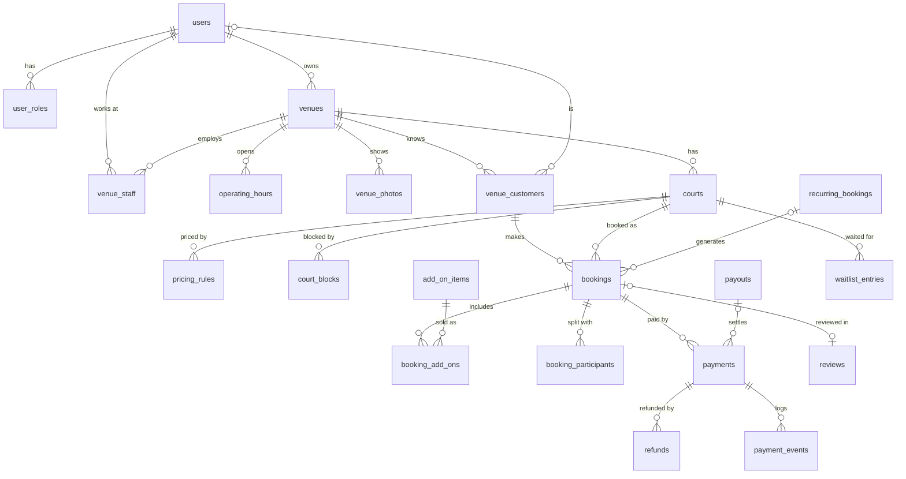
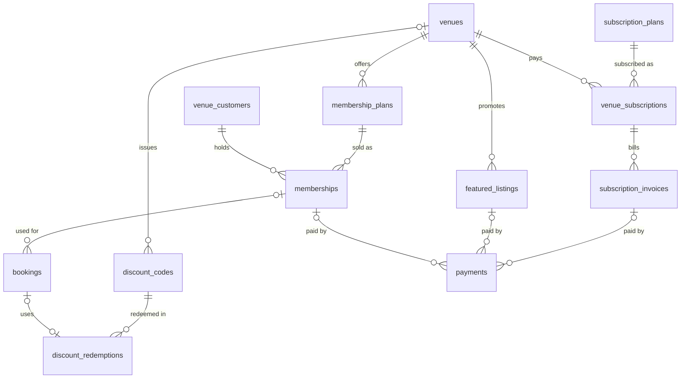
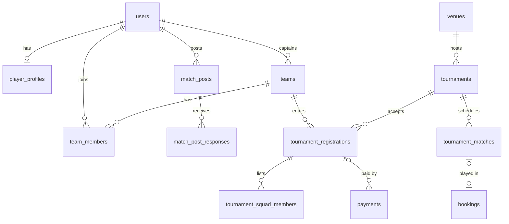
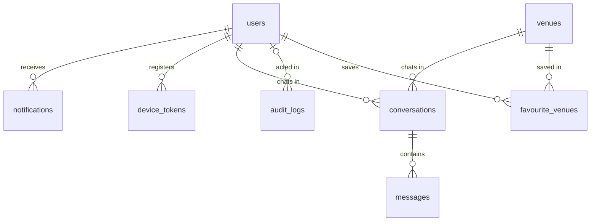

# Database schema

PostgreSQL 18, 48 tables across 10 Flyway migrations in
[`backend/src/main/resources/db/migration`](../../backend/src/main/resources/db/migration).
The migrations are the source of truth; this page explains them.

## Conventions

| Topic | Rule |
|---|---|
| Primary keys | `uuid` generated by `uuidv7()` (time-ordered, index-friendly) |
| Time | Instants are `timestamptz` in UTC. Venue-local rules (opening hours, prices) use `time`/`date` and are read in `venues.timezone` (default `Asia/Kathmandu`) |
| Enumerations | `text` + `CHECK` constraint, mapped in Java with `@Enumerated(EnumType.STRING)` |
| Money | `numeric(12,2)`, NPR |
| Phone numbers | E.164 (`+9779800000000`) |
| `updated_at` | Set by the application (JPA), not triggers |
| Schema changes | Always a new `V<n>__description.sql`; never edit an applied migration |

## Migrations

| Version | Domain | Tables |
|---|---|---|
| V1 | Users and auth | `users`, `user_roles`, `otp_codes`, `refresh_tokens`, `device_tokens` |
| V2 | Venues and courts | `venues`, `venue_photos`, `amenities`, `venue_amenities`, `venue_staff`, `operating_hours`, `courts`, `pricing_rules`, `court_blocks`, `add_on_items` |
| V3 | Customers, memberships, discounts | `venue_customers`, `membership_plans`, `memberships`, `discount_codes` |
| V4 | Teams and players | `player_profiles`, `teams`, `team_members` |
| V5 | Bookings | `recurring_bookings`, `bookings`, `booking_add_ons`, `booking_participants`, `discount_redemptions`, `waitlist_entries` |
| V6 | Matchmaking and tournaments | `match_posts`, `match_post_responses`, `tournaments`, `tournament_registrations`, `tournament_squad_members`, `tournament_matches` |
| V7 | Subscriptions and promotions | `subscription_plans`, `venue_subscriptions`, `subscription_invoices`, `featured_listings` |
| V8 | Payments | `payouts`, `payments`, `payment_events`, `refunds` |
| V9 | Reviews and favourites | `reviews`, `favourite_venues` |
| V10 | Notifications, chat, audit | `notifications`, `conversations`, `messages`, `audit_logs` |

## Key design decisions

**Double booking is impossible at the database level.** `bookings` has an exclusion constraint
(`bookings_no_overlap`): two bookings on the same court whose `[starts_at, ends_at)` ranges overlap
cannot both exist unless one is `CANCELLED` or `EXPIRED`. Back-to-back slots are fine because ranges
are half-open. `court_blocks` has the same rule against overlapping blocks. Overlap *between* a
booking and a block is checked by the application while holding a lock on the court row.

**Slots are not stored.** Available slots are computed from `operating_hours`,
`courts.slot_duration_minutes`, `pricing_rules`, existing `bookings` and `court_blocks`. Only
bookings occupy rows, so changing opening hours or slot length never needs a data migration.

**Every booking has a venue customer.** `venue_customers` is the owner's customer book. Walk-in and
phone bookings create a customer without an app account; app bookings link one via `user_id`. This
gives owners a complete customer list and history whichever way people book.

**Booking lifecycle.** `PENDING_PAYMENT` (slot held until `hold_expires_at`) → `CONFIRMED` →
`COMPLETED` / `NO_SHOW`, or `CANCELLED` / `EXPIRED`. Money columns must satisfy
`total = price + add_ons - discount`; `paid_amount` and `payment_status` track collection.

**Pricing layers by priority.** A court can have many `pricing_rules` (standard, peak, weekend,
holiday, optional date range). The matching rule with the highest `priority` wins.

**Payments are one table for everything.** `payments.purpose` says what is being paid for and exactly
one matching target column must be set (booking, split share, tournament entry, membership,
subscription invoice or featured listing). Cash is recorded by staff (`recorded_by`); eSewa/Khalti/
Fonepay come from gateways, with `(method, gateway_transaction_id)` unique so a callback can't be
applied twice. Raw callbacks go to `payment_events`. Online money owed to venues is settled through
`payouts`, net of commission and refunds.

**Recurring bookings are materialised.** `recurring_bookings` describes the weekly slot; a job
creates real `bookings` a few weeks ahead (`generated_until`), so the overlap constraint protects
them like any other booking.

## Entity relationships

Core booking flow:

Memberships, discounts and monetisation:

Teams, matchmaking and tournaments:

Communication and audit:

